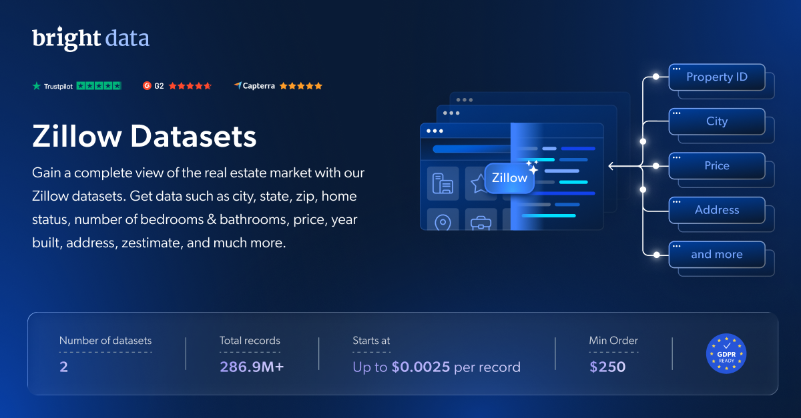

# Zillow 数据集样本

<h2>包含 1001 条 Zillow 房产信息的示例数据集</h2>

<a href="https://www.bright.cn/products/datasets/zillow">
   
</a>

一个包含 1000 多条房产信息的 Zillow 数据集示例。该数据集使用 <b>Bright Data API</b> 提取。

<h2>此免费数据集包含的数据点：</h2>

* ```zpid```：Zillow 房产信息的唯一标识符
* ```url```：房产信息的 URL 或链接
* ```city```：房产所在城市
* ```state```：房产所在州
* ```streetAddress```：房产的街道地址
* ```zipcode```：房产的邮政编码
* ```price```：房产价格
* ```homeStatus```：房屋状态（例如：在售、已售）
* ```homeType```：房屋类型
* ```longitude```：房产的经度坐标
* ```latitude```：房产的纬度坐标
* ```photoCount```：与房产信息关联的照片数量
* ```currency```：价格和估值所使用的货币
* ```livingArea```：房产的总居住面积
* ```lotSize```：地块面积
* ```propertyTaxRate```：房产的房产税率
* ```rentZestimate```：Zillow 对房产租赁价值的估值
* ```description```：房产的文字描述或详细信息
* ```tourViewCount```：房产参观的浏览次数
* ```streetViewMetadataUrlMediaWallLatLong```：使用经纬度获取街景元数据的 URL
* ```isVerifiedClaimedByCurrentSignedInUser```：表示当前登录用户是否已验证其认领的房产信息（True/False）
* ```isZillowOwned```：表示该房产是否归 Zillow 所有（True/False）

以及更多数据点。

这是“Zillow 房产信息（公开数据）”数据集的示例子集，该完整数据集包含超过 <b>134,060,000 处房产</b>。

可用的数据集文件格式：<b>JSON、NDJSON、JSON Lines、CSV 或 Parquet。文件还可选择压缩为 .gz 格式</b>。

数据集交付方式选项：<b>电子邮件、API 下载、Webhook、Amazon S3、Google Cloud Storage、Google Cloud PubSub、Microsoft Azure、Snowflake、SFTP</b>。

更新频率：<b>单次、每日、每周、每月、每季度或自定义周期</b>。

可在已提取的数据点基础上添加数据扩充服务：<b>根据请求提供。</b>

<b>[获取完整的 Zillow 数据集](https://www.bright.cn/products/datasets/zillow)</b>。


<a href="https://www.bright.cn/products/datasets/zillow">
   
</a>

<h2>Zillow 数据集有哪些使用场景？</h2>

<h3>1. 住房需求分析</h3>

利用 Zillow 数据集预测住房需求和销售趋势。通过分析价格最低和最高的时期，识别市场周期并精准把握最佳机会。

<h3>2. 房产价格趋势与增长</h3>

监控 Zillow 上的房产价格，并与本地房地产数据进行比较。按地点分析配套设施，深入了解购房者的预期和市场状况。

<h3>3. 投资洞察</h3>

使用 Zillow 数据集识别租金收益率最高的房产并分析市场动态。挖掘租赁周期、空置率及其他关键指标，从而做出明智的投资决策。

<h2>面向学术研究人员和 NGO 免费开放网页爬虫工具和数据集</h2>

Bright Initiative 为顶尖院系和学术研究人员，以及致力于推动各类环境与社会公益事业的 NGO 和 NPO，提供 Bright Data 的 <b>[网页爬虫工具 API](https://www.bright.cn/products/web-scraper)</b> 和 <b>[即用型数据集](https://www.bright.cn/products/datasets)</b>。你可以在<b>[此处](https://brightinitiative.com)</b>提交申请。
