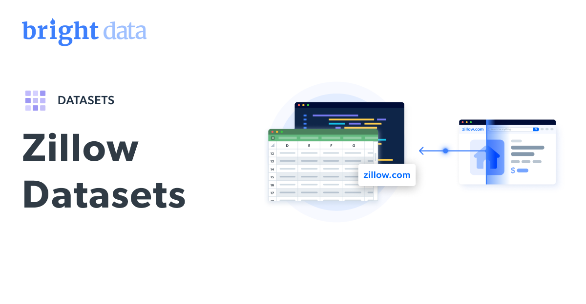

# Zillow 数据集示例

<h2>1001 条 Zillow 房产列表示例数据集</h2>


一个包含 1000+ 条房产列表的 Zillow 数据集示例。该数据集使用 <b>Bright Data API</b> 提取。

<h2>此免费数据集包含的数据点：</h2>

* ```zpid```：Zillow 上该房源的唯一标识符
* ```url```：该房源的链接地址
* ```city```：房产所在城市
* ```state```：房产所在州
* ```streetAddress```：房产街道地址
* ```zipcode```：房产邮政编码
* ```price```：房产价格
* ```homeStatus```：房源状态（例如：在售、已售）
* ```homeType```：房屋类型
* ```longitude```：房产经度
* ```latitude```：房产纬度
* ```photoCount```：该房源关联的照片数量
* ```currency```：价格与估值所用的货币
* ```livingArea```：房屋可居住面积
* ```lotSize```：占地面积
* ```propertyTaxRate```：房产税率
* ```rentZestimate```：Zillow 对该房产租金的估算
* ```description```：关于该房产的文字描述或详情
* ```tourViewCount```：看房（虚拟/预约）浏览次数
* ```streetViewMetadataUrlMediaWallLatLong```：基于经纬度的街景元数据 URL
* ```isVerifiedClaimedByCurrentSignedInUser```：当前登录用户已认领且通过验证（是/否）
* ```isZillowOwned```：是否为 Zillow 自持房源（是/否）

以及更多数据点。

本示例为源自“Zillow 房产列表（公开数据）”数据集的一个子集，该完整数据集包含超过 <b>134,060,000 家</b>公司/实体的相关记录。

可用数据集文件格式：<b>JSON、NDJSON、JSON Lines、CSV、Parquet；支持 .gz 压缩</b>。

数据集交付方式：<b>邮件、API 下载、Webhook、Amazon S3、Google Cloud Storage、Google Cloud Pub/Sub、Microsoft Azure、Snowflake、SFTP</b>。

更新频率：<b>一次性、每日、每周、每月、每季度，或自定义</b>。

数据增强：<b>可按需提供</b>。

<b>[获取完整 Zillow 数据集](https://www.bright.cn/products/datasets/zillow)</b>。



<h2>Zillow 数据集有哪些使用场景？</h2>

<h3>1. 住房需求分析</h3>

利用 Zillow 数据集预测住房需求与销售趋势。识别市场周期，并通过分析最低与峰值价格时段，定位最佳机会。

<h3>2. 房价趋势与增长</h3>

将 Zillow 上的房价与本地化房地产数据进行监测与对比。按地点分析周边配套与设施，从而洞察购房者预期与市场状况。

<h3>3. 投资洞察</h3>

借助 Zillow 数据集识别高租金回报率的房源并分析市场动态。洞察租赁周期、空置率及其他关键指标，辅助做出明智的投资决策。

<h2>为学术研究者与非政府组织提供免费的爬取工具与数据集访问</h2>

Bright Initiative 为顶尖高校与研究人员、以及推动各类环境与社会公益事业的 NGO/NPO，提供对 Bright Data 的 <b>[Web Scraper API](https://www.bright.cn/products/web-scraper)</b> 与 <b>[即用型数据集](https://www.bright.cn/products/datasets)</b> 的访问权限。你可以在<b>[此处](https://brightinitiative.com)</b>提交申请。
